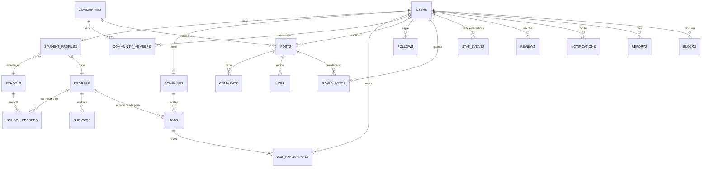

# Base de datos

## Diagrama entidad-relación (borrador)

## Tablas

### Cuentas
- **users**: id, email, password_hash, username, role (`student` | `company` | `admin`), email_verified, created_at, updated_at
- **student_profiles**: user_id, name, surname, bio, avatar_url, location, school_id, degree_id, course
- **companies**: user_id, name, sector, location, logo_url, website, contact_name, verified

### Académico
- **schools**: id, name, type (universidad / FP / instituto), city, province
- **degrees**: id, name, level (FP medio, FP superior, grado, máster)
- **school_degrees**: school_id, degree_id
- **subjects**: id, degree_id, name, course

### Trabajos
- **jobs**: id, company_id, title, description, requirements, type (`puntual` | `practicas` | `temporal` | `indefinido` | `freelance`), category (una de las 21 de InfoJobs), schedule (`completa` | `parcial` | `flexible` | `fines_semana`), modality (`presencial` | `hibrido` | `remoto`), pay, pay_period (`hora` | `mes` | `total`), location (ciudad), province (o `Extranjero`), remote, vacancies, degree_id (estudios recomendados), deadline, status (`abierta` | `cerrada`), created_at, updated_at
- **job_applications**: id, job_id, student_id, message, status (`enviada` = Inscrito | `vista` = CV leído | `en_proceso` | `aceptada` = Seleccionado | `rechazada` = Descartado), created_at, updated_at

### Comunidad
- **communities**: id, name, description, type (`degree` | `subject` | `school` | `general` | `group`), target_id, topic, privacy (`public` | `private`), cover_url, province, creator_id, created_at → [[decisiones/ADR-008-sugerencias-grupos]]
- **community_members**: community_id, user_id, joined_at, role (`admin` | `member`)
- **community_dismissals**: user_id, community_id, created_at (grupos quitados de las sugerencias)
- **posts**: id, user_id, community_id (nullable), type (`pregunta` | `recurso` | `debate` | `general`), content, image_url, file_url, created_at, updated_at
- **comments**: id, post_id, user_id, content, created_at
- **likes**: user_id, post_id
- **follows**: follower_id, followed_id, created_at (para contar seguidores nuevos)
- **saved_posts**: user_id, post_id, created_at (sección Guardados)
- **shares**: user_id, post_id, created_at

### Reseñas
- **reviews**: id, user_id, target_type (`school` | `degree` | `subject`), target_id, rating_general, rating_dificultad, rating_utilidad, comment, created_at

### Sistema
- **notifications**: id, user_id, type, data, read, created_at
- **reports**: id, reporter_id, target_type, target_id, reason, status
- **blocks**: blocker_id, blocked_id
- **stat_events**: id, owner_id, kind (`profile_view` | `search_appearance` | `post_impression`), actor_id, post_id, created_at → [[decisiones/ADR-006-estadisticas]]

## Pendiente de decidir
- [ ] ¿Guardar la fecha de nacimiento o solo "tiene 16 o más"?
- [ ] ¿Las reseñas son anónimas para el público pero no para los moderadores?
