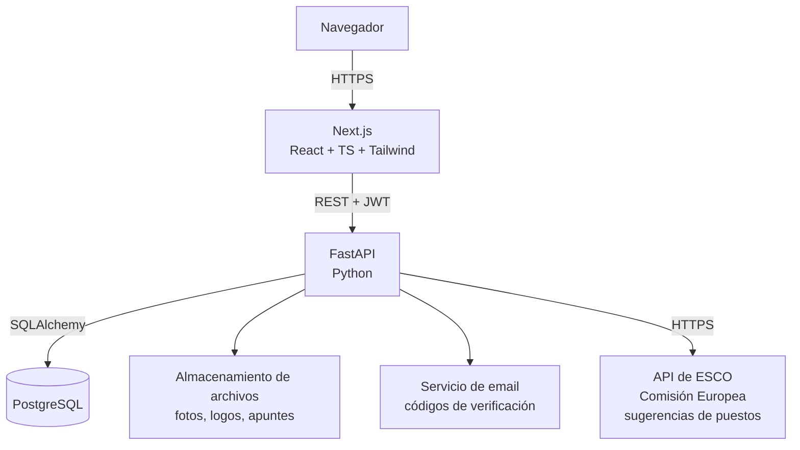

# Arquitectura

## Servicios externos
- **ESCO** (`https://ec.europa.eu/esco/api`): sugerencias de puestos para el buscador de Empleo. Caché de 24 h y lista local si no responde → [[decisiones/ADR-005-puestos-esco]].

## Organización del código
- `backend/app/routers/`: un archivo por grupo de endpoints (auth, posts, jobs, stats, catalog…)
- `backend/app/services/`: lógica compartida (people, occupations, stats)
- `frontend/src/app/`: una carpeta por pantalla (`empleo`, `guardados`, `estadisticas`, `ajustes`…)
- `frontend/src/lib/`: llamadas a la API (`api.ts`), datos de Empleo (`jobs.ts`) e idioma (`i18n.ts`)

## Más adelante (fase 2)
- **Redis**: caché y notificaciones en tiempo real
- **WebSockets**: chat
- **Servicio de IA**: recomendaciones de ofertas y comunidades

## Despliegue (por decidir)
- Frontend: Vercel
- Backend + BD: Railway / Render / VPS con Docker
