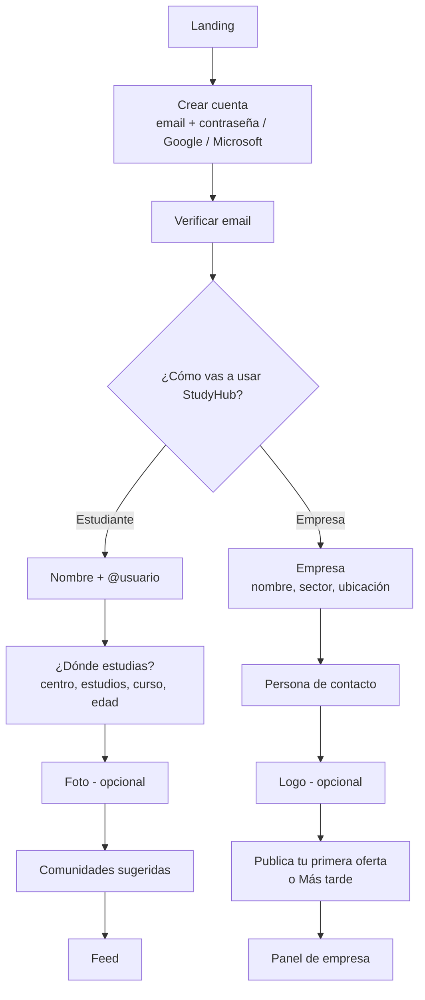

# Flujo de registro y onboarding

## Flujo propuesto

## Pantallas v1 (Figma)
![[assets/pantallas-v1/01.png]]
![[assets/pantallas-v1/02.png]]
![[assets/pantallas-v1/03.png]]
![[assets/pantallas-v1/04.png]]
![[assets/pantallas-v1/05.png]]
![[assets/pantallas-v1/06.png]]
![[assets/pantallas-v1/07.png]]
![[assets/pantallas-v1/08.png]]
![[assets/pantallas-v1/09.png]]

## Cambios para la v2
### 🔴 Críticos
- [ ] Añadir pantalla "¿Cómo vas a usar StudyHub?" y el camino de empresa
- [ ] La landing debe explicar qué es la app (trabajos, foros, reseñas)
- [ ] Botón "Subir foto" en la pantalla de foto
- [ ] Eliminar la pantalla "Descargar la app" (no hay app móvil en el MVP)

### 🟡 Importantes
- [ ] Mover la verificación de email justo después de crear la cuenta
- [ ] Quitar "Recordarme" del registro
- [ ] Quitar "Mostrar" del campo Apellidos
- [ ] Placeholders en gris; Ubicación con autocompletado
- [ ] Placeholder de universidad: "Ej.: Universidad de Granada"
- [ ] Comunidades sugeridas con contenido real y botón "Seguir"
- [ ] Botón atrás como secundario ("← Atrás"), no rojo
- [ ] "Reenviar código" como enlace con cuenta atrás
- [ ] Botón de Google blanco con borde (normas de marca de Google)
- [ ] "Continuar con Microsoft" en vez de "Continuar como CUENTA MICROSOFT"

### 🟢 Consistencia
- [ ] Aplicar la paleta de [[sistema-diseno]]
- [ ] Una sola tipografía
- [ ] Mismo ancho de tarjeta en todas las pantallas
- [ ] Mismo fondo en todo el flujo
- [ ] Logo del mismo tamaño en todas las pantallas
- [ ] Botón atrás en todas las pantallas del onboarding
- [ ] Checkboxes con ✓ visible
